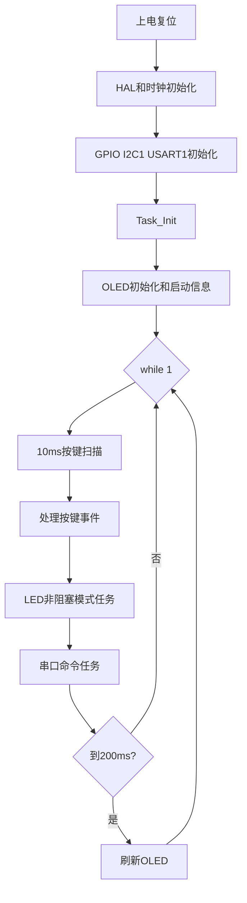
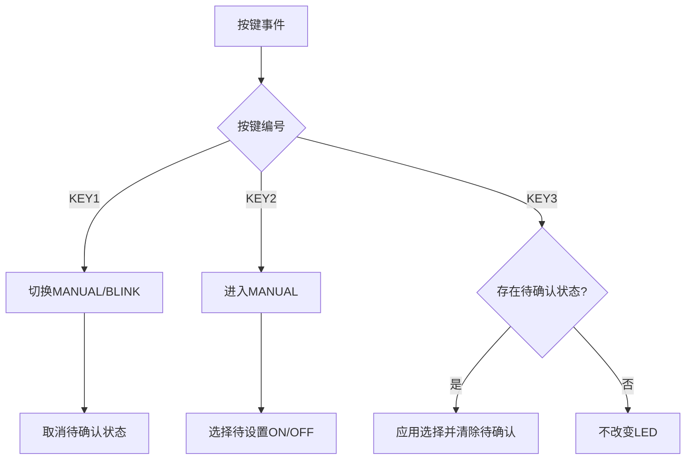
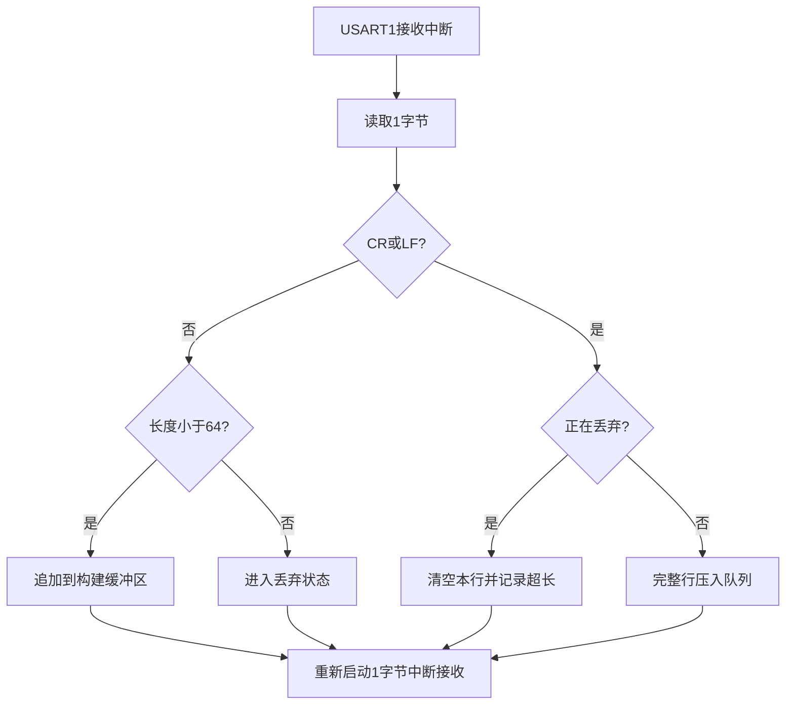

# 分层设计说明

## 1. 总体数据流

```text
按键/CH340
    |
    v
Component/Device
    |
    v
Module 统一业务状态和命令动作
    |
    v
Task 周期调度
    |
    +----> BSP 板载 LED
    +----> Device SSD1306 OLED
```

代码依赖方向：

```text
Core/main.c
    -> Task
        -> Module
            -> Component / Device
                -> BSP
                    -> STM32 HAL
```

上层调用下层接口，下层不反向依赖业务层。

## 2. 各层职责

### BSP

`bsp_led.c/.h` 封装 PC13 板载 LED 的低有效电平。上层只使用“点亮、熄灭、翻转、读取状态”，不关心 GPIO 电平细节。

### Component

`key.c/.h` 管理 PA0、PA1、PA2 三个按键。Task 每 10 ms 调用扫描函数；连续两次采样一致后更新稳定状态，只在稳定按下沿产生一次事件。

### Device

`ssd1306.c/.h` 负责 OLED 初始化、帧缓冲绘制和 I2C 刷新。

`uart_line.c/.h` 使用 USART1 中断逐字节接收，支持 CR、LF、CRLF，组成完整命令行后放入队列。中断不解析命令、不发送回复、不刷新 OLED。

### Module

`led_module.c/.h` 保存 MANUAL/BLINK 模式、LED 状态、闪烁周期和非阻塞闪烁时间戳。

`command.c/.h` 负责命令规范化、匹配、执行、回复以及成功/错误计数。

### Task

`app_task.c/.h` 负责：

- 10 ms 按键扫描；
- KEY1 模式切换；
- KEY2 选择待确认 LED 状态；
- KEY3 确认；
- LED 模块周期运行；
- 命令任务运行；
- 200 ms OLED 页面刷新。

### Core/main.c

只负责 HAL、时钟和外设初始化，调用 `Task_Init()` 与 `Task_Run()`，并将 `HAL_UART_RxCpltCallback()` 转发给 Task/Device。

## 3. 主循环流程



## 4. 按键状态流程



## 5. 串口接收流程



主循环从队列取出命令，执行规范化和匹配。未知命令、超长命令不会改变 LED 状态。

## 6. 非阻塞设计

运行阶段使用 `HAL_GetTick()` 判断 10 ms、200 ms 和 500 ms 周期，不在主循环使用 `HAL_Delay()`。因此 OLED 刷新、LED 闪烁、按键和串口命令可以并行响应。

SSD1306 初始化阶段允许一次短暂上电延时，完成初始化后进入非阻塞调度。

## 7. 状态一致性

- LED 实际输出通过 LED Module/BSP 修改。
- OLED 每次刷新读取 LED Module 当前状态。
- `STATUS` 读取相同状态。
- 串口 LED 命令先切换 MANUAL，再设置或翻转 LED。

因此实际 LED、OLED 和串口状态保持一致。
